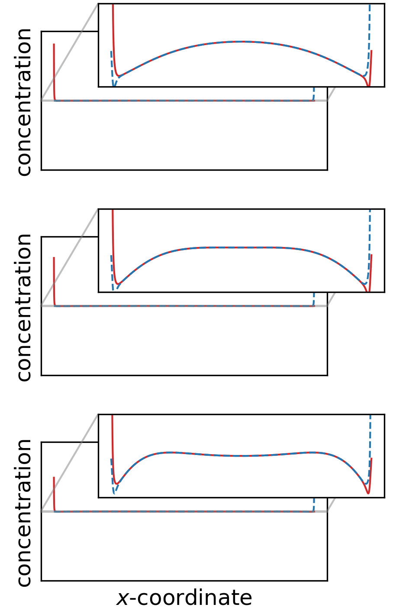
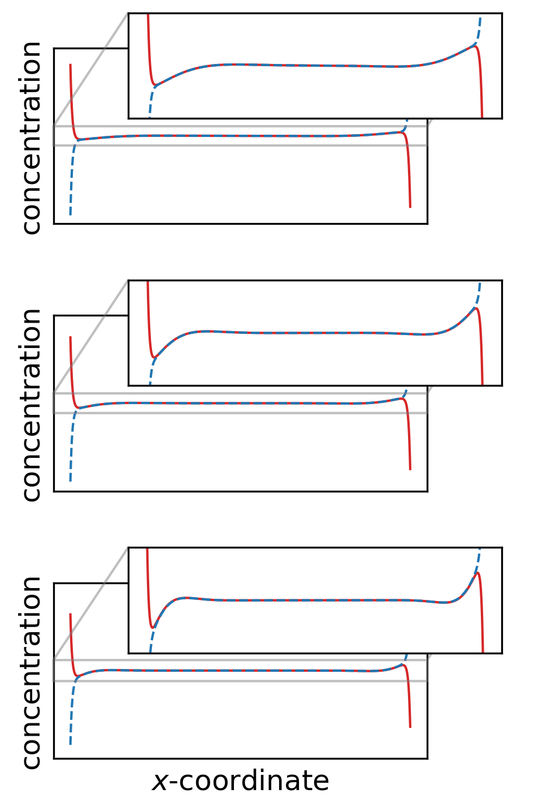

# Concentration-profile perturbations

  <h3>Applied voltage bias</h3>
  

  <!-- <a href="#popup_1">Show more</a> -->

<!--
-->

  <h3>Unequal diffusion coefficients</h3>
  

  <!-- <a href="#popup_2">Show more</a> -->

<!-- 

  

    <h3>{{item.title}}</h3>
    <a class="close" href="#">&times;</a>
    
    

    
    {{item.abstract}}
    <a href="#">Close</a>
  

 -->

<!-- end card-container -->