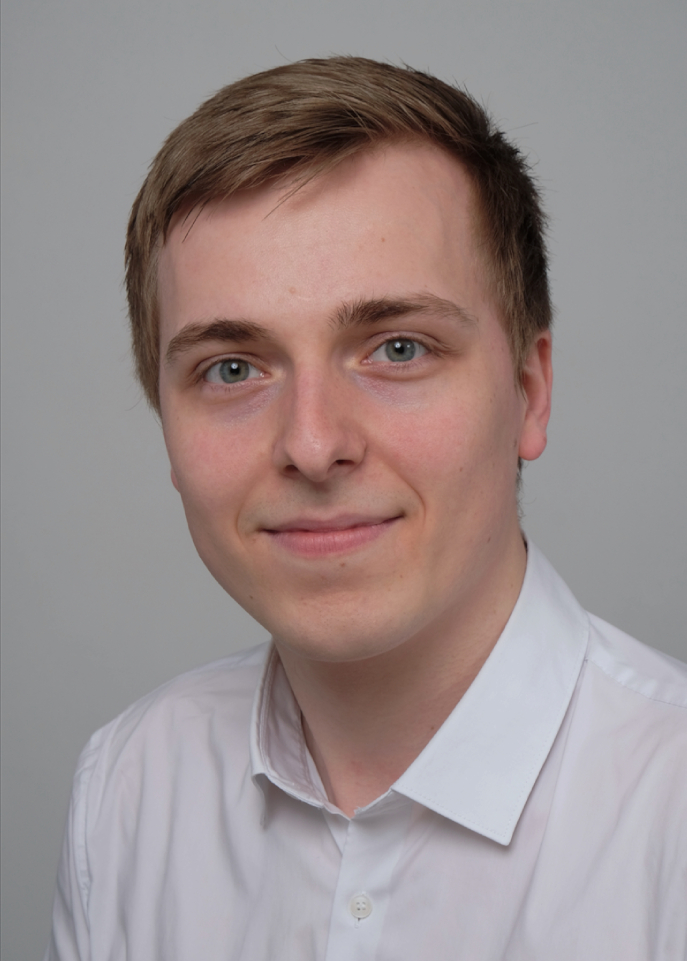

I am a physicochemist with a specialization in numerical simulations of electrochemical equilibria at solid/solid and solid/liquid interfaces. I work on theoretical models and computational techniques that shall help bridge the gaps from atomistic to mesoscopic and from mesoscopic to macroscopic length scales. In this way, my research contributes to the understanding of electrochemical processes in energy storage devices like supercapacitors and batteries.

## Timeline
**Postdoctoral Research:**
Since 2025 in the group of Prof. Mathijs Janssen at NMBU (&Aring;s, Norway)

**Doctorate:**
2020&ndash;2025 in the group of Prof. R. A. De Souza at RWTH Aachen University (Aachen, Germany). Dissertation titled [Investigation of charge and mass transport in ion-conducting solids by means of continuum and atomistic simulations](https://doi.org/10.18154/RWTH-2025-05829)

**MSc:**
2017&ndash;2019 in Chemistry at RWTH Aachen University

**BSc**
2014&ndash;2017 in Chemistry at RWTH Aachen University

## Music
Beside my work as a Physical Chemist, I am an enthusiastic trumpet player and co-organiser of the ensemble [Aachener Barockorchester](https://www.instagram.com/aachenerbarockorchester/). I also play in the ensembles [Aachener Studentenorchester](https://www.aso.rwth-aachen.de/) and [Bläserphilharmonie Aachen](https://blaeserphilharmonie-aachen.de/).